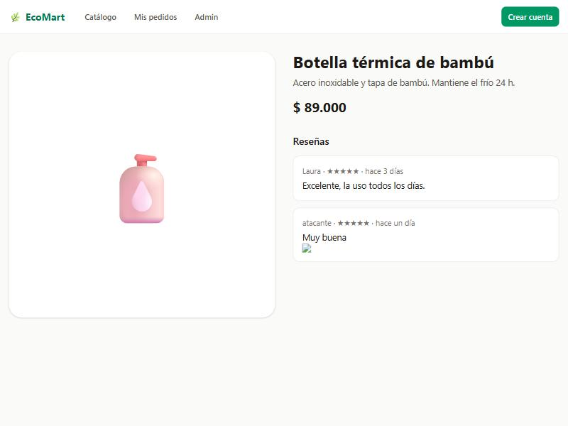
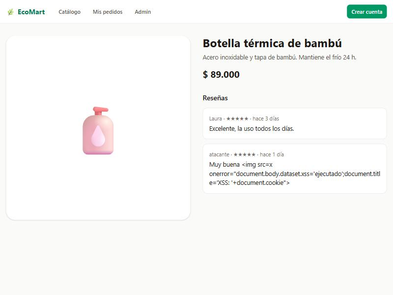
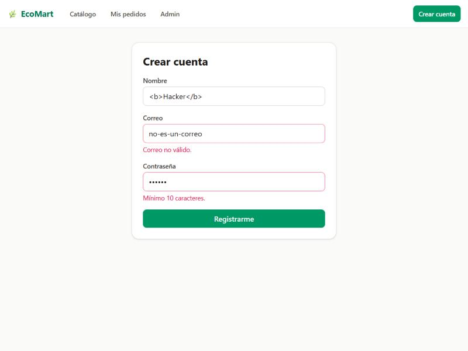
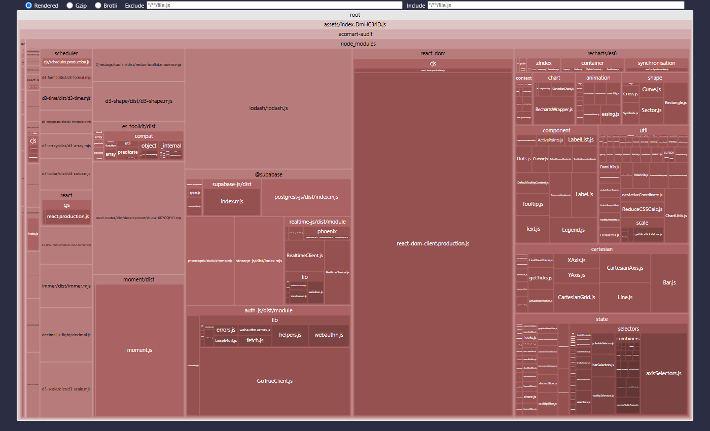
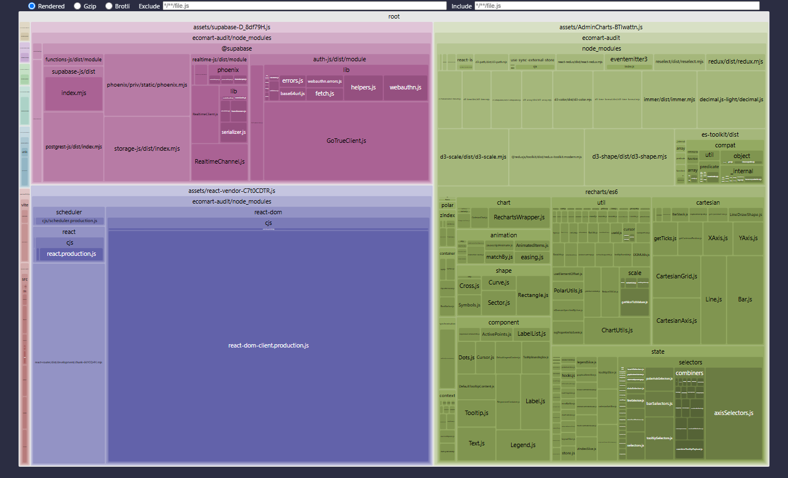

# EcoMart · Auditoría de IA y Optimización Final 🌿🔒

Proyecto integrador del módulo 5 (Despliegue y Fortalecimiento): auditoría de seguridad y rendimiento de **EcoMart**, un e-commerce sostenible en **React 19 + Vite 8 + Supabase**, antes de su salida a producción.

| | Antes | Después |
|---|---|---|
| Ataques RLS exitosos (PostgreSQL) | **8 / 8** | **0 / 8** |
| XSS persistente en reseñas | se ejecuta | neutralizado |
| `service_role` en el cliente | aceptada | build bloqueado + escáner |
| JS inicial (gzip) | **300,75 KB** | **141,70 KB (−52,9 %)** |
| Chunks | 1 (>500 KB) | 9 (por ruta y vendor) |

## 📄 Entregables

| Entregable | Dónde |
|---|---|
| **Informe de auditoría** (3 hallazgos críticos, diálogo con la IA, correcciones) | [`docs/INFORME_AUDITORIA.md`](docs/INFORME_AUDITORIA.md) |
| **Reporte de optimización** (antes/después) | [Sección 4 del informe](docs/INFORME_AUDITORIA.md#4-optimización-del-bundle) · [`reports/`](reports) · treemaps interactivos [antes](reports/bundle-antes.html) / [después](reports/bundle-despues.html) |
| **Código mejorado** | RLS: [`hardening_auditoria.sql`](supabase/migrations/20261111180000_hardening_auditoria.sql) · Componentes: [`Register.tsx`](src/pages/Register.tsx), [`ProductDetail.tsx`](src/pages/ProductDetail.tsx) · Rutas: [`App.tsx`](src/App.tsx) · Build: [`vite.config.ts`](vite.config.ts) |

👉 Para ver el código **vulnerable original**: tag [`antes-auditoria`](../../tree/antes-auditoria) (`git diff antes-auditoria main`).

## 🔁 Reproducir la verificación

```bash
npm install
npm run build          # build + saneado de reportes + escaneo de secretos (postbuild)
npm run analyze        # peso por paquete y por chunk
npm run lint
```

Pruebas de RLS (PostgreSQL 16, simulando `auth.uid()`/`auth.jwt()` de Supabase):

```bash
# Esquema vulnerable  -> 8 × VULNERABLE
psql -d antes   -f supabase/tests/00_supabase_stubs.sql -f supabase/migrations/20261111170000_esquema_inicial.sql -f supabase/tests/10_ataques_rls.sql
# Esquema endurecido -> 8 × BLOQUEADO + flujos legítimos OK
psql -d despues -f supabase/tests/00_supabase_stubs.sql -f supabase/migrations/20261111170000_esquema_inicial.sql \
                -f supabase/migrations/20261111180000_hardening_auditoria.sql -f supabase/tests/10_ataques_rls.sql -f supabase/tests/20_flujos_legitimos.sql
```

Resultados guardados: [`reports/rls-antes.txt`](reports/rls-antes.txt), [`reports/rls-despues.txt`](reports/rls-despues.txt), [`reports/hardening-checks.txt`](reports/hardening-checks.txt).

## 📸 Evidencia

| XSS antes (se ejecuta) | XSS después (texto) | Registro validado |
|---|---|---|
|  |  |  |

| Bundle antes (1 chunk) | Bundle después (code splitting) |
|---|---|
|  |  |

## 🔐 Variables de entorno

```bash
cp .env.example .env   # solo VITE_SUPABASE_URL y VITE_SUPABASE_ANON_KEY
```

La `service_role` **nunca** va en el frontend: el build falla si existe una variable `VITE_*SERVICE*`/`*SECRET*`. Para Edge Functions usa `npx supabase secrets set SUPABASE_SERVICE_ROLE_KEY=…`.

Sin `.env` la app corre en modo demo con datos de ejemplo (incluida una reseña maliciosa para demostrar el XSS).
