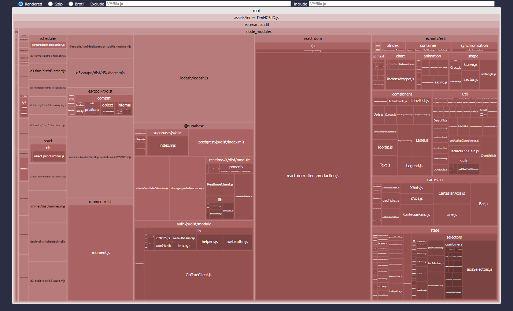
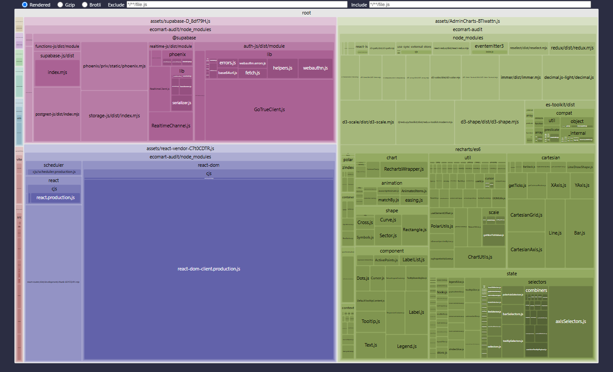

# Informe de Auditoría de IA: EcoMart (pre-lanzamiento)

| | |
|---|---|
| **Proyecto** | EcoMart: comercio electrónico sostenible (React 19 + Vite 8 + Supabase) |
| **Alcance** | Componentes React (registro, reseñas, pedidos, admin), cliente de Supabase, políticas RLS, configuración de build |
| **Metodología** | Arquitectura Basada en Especificaciones: especificación de seguridad y rendimiento → auditoría asistida por IA → **prueba de explotación** → corrección → **re-verificación** |
| **Estado inicial** | Commit con tag `antes-auditoria` |

## Resumen ejecutivo

| Métrica | Antes | Después | Cambio |
|---|---|---|---|
| Ataques RLS exitosos (8 pruebas en PostgreSQL) | **8 / 8** | **0 / 8** | ✅ todos bloqueados |
| XSS persistente en reseñas | Se ejecuta | Neutralizado | ✅ |
| `service_role` aceptada en el cliente | Sí (fallback) | Build bloqueado + escáner | ✅ |
| JS de la carga inicial (gzip) | **300,75 KB** | **141,70 KB** | **−52,9 %** |
| JS de la carga inicial (minificado) | 1.021,52 KB | 483,41 KB | −52,7 % |
| Chunks | 1 (supera el aviso de 500 KB) | 9 (por ruta y por vendor) | ✅ |
| Dependencias eliminadas | — | `moment`, `lodash` | 2 librerías menos |

---

## 1. Especificación de la auditoría (el "plano")

Antes de pedirle nada a la IA definí qué significa "seguro" y "rápido" para EcoMart:

- **SEC-1:** el navegador solo puede tener la `anon key`. Ninguna clave con privilegios puede llegar al bundle.
- **SEC-2:** un usuario solo puede leer sus propios datos personales y pedidos. Los datos internos (costos, proveedores) no salen de la BD.
- **SEC-3:** el cliente nunca decide ni su rol ni el precio de un pedido.
- **SEC-4:** ningún dato escrito por un usuario se interpreta como HTML.
- **PERF-1:** la página de entrada (catálogo) debe cargar menos de 150 KB de JS gzip.
- **PERF-2:** las librerías que solo usa una ruta se cargan solo en esa ruta.

Cada hallazgo se considera **cerrado solo si existe una prueba automatizada** que lo explota antes y falla después.

---

## 2. Diálogo iterativo con la IA

### Prompt 1: Auditoría de seguridad estática

```text
Actúa como un experto en ciberseguridad de aplicaciones web (OWASP Top 10 2021, OWASP ASVS)
especializado en React y Supabase (PostgreSQL + RLS + GoTrue).

CONTEXTO: EcoMart es un e-commerce en React 19 + Vite que usa supabase-js desde el navegador.
Modelo de amenazas: (1) visitante anónimo, (2) cliente autenticado malicioso que modifica
peticiones con las DevTools, (3) atacante que publica contenido (reseñas).

ENTRADA: te adjunto Register.tsx, ProductDetail.tsx, services/api.ts, lib/supabase.ts y la
migración SQL con las políticas RLS.

TAREA: encuentra vulnerabilidades de XSS, inyección, fallos de autenticación/autorización,
exposición de datos y gestión de secretos.

RESTRICCIONES:
- Cita la línea exacta del código vulnerable.
- Distingue lo que es explotable desde el navegador de lo que es "mala práctica".
- No propongas mover la lógica a un backend propio: debe resolverse con RLS, GRANTs,
  funciones de Postgres y buenas prácticas en React.

FORMATO: tabla | ID | Severidad (Crítica/Alta/Media) | OWASP | Archivo:línea | Vector de ataque |
Corrección propuesta |, ordenada por severidad. Después, el código corregido de los 3 más críticos.
```

**Resultado:** 8 hallazgos de RLS (A1–A8) más los de frontend y configuración de las secciones 3 y "Otros hallazgos". Los más graves fueron el fallback a `VITE_SUPABASE_SERVICE_ROLE_KEY`, las políticas `using (true)` en `profiles` y `orders`, el `dangerouslySetInnerHTML` en reseñas y registro, y el rol tomado de `user_metadata`.

**Decisiones de diseño sobre las correcciones:**
- **XSS:** se descartó sanitizar con DOMPurify. Las reseñas no necesitan formato, así que basta con renderizarlas como texto plano (React escapa por defecto), sin dependencias nuevas ni reglas que mantener.
- **Rol en `user_metadata`:** se clasificó como **Crítica** y no como "mala práctica", porque cualquier usuario puede ejecutar `supabase.auth.updateUser({ data: { role: 'admin' } })` desde la consola del navegador.

### Prompt 2: Iteración "demuéstralo"

```text
Para CADA hallazgo de RLS, escribe una prueba SQL que lo explote en PostgreSQL simulando
a Supabase (roles anon/authenticated, auth.uid() y auth.jwt() leídos de request.jwt.claims).
Cada prueba debe imprimir VULNERABLE o BLOQUEADO y no abortar. Incluye además una prueba
funcional: un usuario legítimo debe seguir viendo SU perfil y SUS pedidos.
Luego escribe una migración de hardening que haga pasar todas a BLOQUEADO sin romper la
prueba funcional. Usa privilegios por columna (GRANT) donde RLS no alcance, y
`set search_path = ''` en toda función SECURITY DEFINER.
```

**Resultado:** [`supabase/tests/10_ataques_rls.sql`](../supabase/tests/10_ataques_rls.sql) y [`20261111180000_hardening_auditoria.sql`](../supabase/migrations/20261111180000_hardening_auditoria.sql).

**Por qué una política no bastaba para A5:** una política `with check (auth.uid() = user_id)` sobre `orders` impide comprar a nombre de otro, pero no que el cliente envíe `total_cop = 1`. RLS controla **quién** escribe una fila, no **qué valores** son correctos. Por eso se quitó el `INSERT` directo y se creó la RPC `place_order()`, que toma el precio de `products` en la base de datos.

### Prompt 3: Optimización del bundle

```text
Este es el reporte de rollup-plugin-visualizer de EcoMart (un único chunk de 1.021 KB,
300 KB gzip). Paquetes más pesados: recharts 179 KB gz (solo lo usa /admin), react-dom 99 KB,
lodash 38 KB (usamos round, groupBy y sortBy), moment 28 KB (format y fromNow).
Rutas: /, /producto/:id, /registro, /cuenta/pedidos, /admin.

Propón una estrategia de code splitting con React.lazy + Suspense y reemplazos de librerías
para que la ruta "/" cargue menos de 150 KB gzip. Restricciones: Vite 8 (rolldown), sin
cambiar de framework, y el catálogo NO puede mostrar spinner (es la página de entrada).
Justifica cada cambio con el ahorro estimado.
```

**Estrategia inicial:** lazy en las 4 rutas secundarias (el catálogo queda en el chunk inicial), `moment` → `date-fns`, `lodash` → funciones nativas, y separar vendors con `codeSplitting.groups`.

**Iteraciones después de medir:**
1. Al revisar la red en el build de producción vi que un cliente **no-admin** que entra a `/admin` igual descargaba recharts (110 KB) solo para ver "Acceso denegado". Separé los gráficos en `AdminCharts.tsx` con un segundo `lazy()`, que solo se carga después de confirmar el rol.
2. El reporte mostraba **date-fns (≈11 KB gz) en el chunk inicial** por el locale `es`. Lo reemplacé por `Intl.RelativeTimeFormat` (nativo, 0 KB) y eliminé la dependencia.

### Prompt 4: Hardening de variables de entorno

```text
¿Cómo garantizo en un proyecto Vite que NUNCA llegue la service_role de Supabase al bundle,
aunque un desarrollador la ponga por error en .env? Quiero tres capas: (1) que el build falle,
(2) un escáner post-build del dist/, (3) una validación en runtime. Dame el código.
```

**Resultado:** plugin `forbid-secret-env` en `vite.config.ts`, [`scripts/check-secrets.mjs`](../scripts/check-secrets.mjs) como `postbuild` y validación del claim `role` del JWT en [`src/lib/env.ts`](../src/lib/env.ts). Las tres capas se probaron a propósito ([`reports/hardening-checks.txt`](../reports/hardening-checks.txt)).

---

## 3. Los 3 hallazgos más críticos

### 🔴 CRÍTICO 1: `service_role` en el cliente (bypass total de RLS)

| | |
|---|---|
| **OWASP** | A02 Cryptographic Failures / A05 Security Misconfiguration |
| **Dónde** | `src/lib/supabase.ts` (antes) |
| **Impacto** | La `service_role` **ignora todas las políticas RLS**. Cualquiera puede extraerla del JS público y leer, modificar o borrar la base de datos completa. |

```ts
// ❌ ANTES
const key = import.meta.env.VITE_SUPABASE_SERVICE_ROLE_KEY || import.meta.env.VITE_SUPABASE_ANON_KEY
```

**Corrección en tres capas:**

```ts
// ✅ 1. vite.config.ts: el build FALLA si existe una variable VITE_* con aspecto de secreto
const leaked = Object.keys(loadEnv(mode, process.cwd(), 'VITE_')).filter((k) => /SERVICE|SECRET|PRIVATE|PASSWORD/i.test(k))
if (leaked.length) throw new Error(`[seguridad] Variables secretas expuestas al cliente: ${leaked.join(', ')}`)

// ✅ 2. src/lib/env.ts: aunque pongan la service_role como "anon key", la app no arranca
if (anonKey && decodeJwtRole(anonKey) === 'service_role') throw new Error('Configuración insegura…')

// ✅ 3. scripts/check-secrets.mjs (postbuild): escanea dist/ buscando JWT role=service_role,
//    claves sb_secret_…, claves PEM y source maps
```

**Verificación** (`reports/hardening-checks.txt`):
```
[seguridad] Variables secretas expuestas al cliente: VITE_SUPABASE_SERVICE_ROLE_KEY. Muévelas al servidor.
❌ Secretos o artefactos sensibles en dist/: dist/assets/index-*.js: JWT con role=service_role
✅ 14 archivos revisados en dist/: sin service_role, claves secretas ni source maps.
```

### 🔴 CRÍTICO 2: RLS permisivo (exposición de datos y escalada a admin)

| | |
|---|---|
| **OWASP** | A01 Broken Access Control |
| **Dónde** | `20261111170000_esquema_inicial.sql`, `services/api.ts` |
| **Impacto** | Un anónimo descarga teléfonos y direcciones de todos los clientes (A2). Un cliente lee los pedidos de otros (A3), **se asciende a admin** con un `UPDATE` (A4) o al registrarse enviando `role=admin` (A8), compra a $1 (A5) y publica reseñas a nombre de otros (A6). |

```sql
-- ❌ ANTES
create policy "profiles_select" on public.profiles for select using (true);
create policy "profiles_update" on public.profiles for update using (auth.uid() = id); -- ¡incluye la columna role!
create policy "orders_select"   on public.orders   for select to authenticated using (true);
create policy "orders_insert"   on public.orders   for insert to authenticated with check (true);
-- trigger: coalesce(new.raw_user_meta_data ->> 'role', 'customer')  ← el cliente elige su rol
```

```sql
-- ✅ DESPUÉS
create function public.is_admin() returns boolean language sql stable set search_path = '' as $$
  select coalesce((select auth.jwt()) -> 'app_metadata' ->> 'role', '') = 'admin';  -- app_metadata: solo el servidor la escribe
$$;

revoke insert, update, delete on public.profiles from authenticated;
grant update (full_name, phone, address) on public.profiles to authenticated;   -- `role` NO es editable

create policy "profiles: el dueño (o un admin) lee el perfil" on public.profiles for select to authenticated
  using ((select auth.uid()) = id or (select public.is_admin()));

create policy "orders: el cliente ve sus pedidos (admin ve todos)" on public.orders for select to authenticated
  using ((select auth.uid()) = user_id or (select public.is_admin()));
revoke insert on public.orders from authenticated;  -- solo vía RPC place_order(): el precio lo pone la BD

grant select (id, name, description, price_cop, co2_saved_kg, category, created_at)
  on public.products to anon, authenticated;        -- cost_cop y supplier_email ya no son legibles
```

**Verificación en PostgreSQL 16** ([`reports/rls-antes.txt`](../reports/rls-antes.txt) → [`reports/rls-despues.txt`](../reports/rls-despues.txt)):

| Ataque | Antes | Después |
|---|---|---|
| A1 · anónimo lee costo y email del proveedor | VULNERABLE | BLOQUEADO |
| A2 · anónimo lee teléfonos y direcciones | VULNERABLE | BLOQUEADO |
| A3 · lee pedidos de otros clientes | VULNERABLE | BLOQUEADO |
| A4 · se auto-asciende a admin (`UPDATE role`) | VULNERABLE | BLOQUEADO |
| A5 · pedido pagando $1 | VULNERABLE | BLOQUEADO |
| A6 · reseña suplantando a otro usuario | VULNERABLE | BLOQUEADO |
| A7 · reseña con rating = 500 | VULNERABLE | BLOQUEADO |
| A8 · registro con `user_metadata.role=admin` | VULNERABLE | BLOQUEADO |
| Funcional: Ana ve su perfil y pedidos | OK | OK |
| Funcional: `place_order` calcula 2 × 89.000 = 178.000 | — | OK |
| Funcional: admin real (`app_metadata`) ve todos los pedidos | — | OK |
| Funcional: `user_metadata.role=admin` NO da privilegios | — | OK |

### 🔴 CRÍTICO 3: XSS persistente (reseñas) y reflejado (registro)

| | |
|---|---|
| **OWASP** | A03 Injection (XSS) |
| **Dónde** | `ProductDetail.tsx` y `Register.tsx` (antes) |
| **Impacto** | Una reseña con `` ejecuta JavaScript en el navegador de **cada visitante**. Puede robar el token de sesión de Supabase guardado en `localStorage` y suplantar al usuario. Verificado en el navegador: el título de la pestaña cambió a `XSS:` ([captura](capturas/01-antes-xss-ejecutado.jpg)). |

```tsx
// ❌ ANTES: ProductDetail.tsx
<p className="mt-1" dangerouslySetInnerHTML={{ __html: r.body }} />
// ❌ ANTES: Register.tsx (el nombre del usuario se inyecta como HTML) + open redirect
{message && <p dangerouslySetInnerHTML={{ __html: message }} />}
window.location.href = params.get('next') || '/'   // ?next=javascript:… o //evil.com
```

```tsx
// ✅ DESPUÉS: React escapa el texto; el HTML del atacante se muestra pero no se ejecuta
<p className="mt-1 whitespace-pre-line break-words">{r.body}</p>

// ✅ Redirección solo a rutas internas
navigate(safeRedirectPath(params.get('next')), { replace: true })
export function safeRedirectPath(next: string | null, fallback = '/') {
  if (!next || !/^\/(?![/\\])/.test(next)) return fallback          // bloquea //evil.com, /\evil, javascript:
  const url = new URL(next, window.location.origin)
  return url.origin === window.location.origin ? url.pathname + url.search + url.hash : fallback
}
```

Defensa en profundidad: `public/_headers` agrega una **Content-Security-Policy** (`script-src 'self'`, sin inline), así que aunque apareciera un nuevo `dangerouslySetInnerHTML`, el script inyectado no se ejecutaría en producción (Netlify).

**Verificación:** con el mismo payload la reseña se muestra como texto ([captura](capturas/02-despues-xss-neutralizado.jpg)), `document.body.dataset.xss === undefined`, y `/registro?next=//evil.example.com/phish` redirige a `/`.

### Otros hallazgos corregidos

| ID | Severidad | Hallazgo | Corrección |
|---|---|---|---|
| A7 | Media | Sin validación de datos en reseñas | `CHECK (rating between 1 and 5)`, longitud de `body`, `author_name` lo pone un trigger |
| M-1 | Media | `select('*')` en todas las consultas | Columnas explícitas; además los GRANT por columna lo bloquean en la BD |
| M-2 | Media | Contraseña mínima de 6 caracteres | Mínimo 10 con mayúsculas, minúsculas y números (también configurable en Supabase Auth) |
| M-3 | Baja | El mensaje de error revelaba si el correo existía | Mensaje genérico (evita enumerar usuarios) |
| M-4 | Baja | Funciones `SECURITY DEFINER` sin `search_path` | `set search_path = ''` + `revoke execute … from public, anon` |
| M-5 | Baja | Source maps y sin cabeceras de seguridad | `sourcemap: false`, CSP, `X-Frame-Options`, HSTS en `public/_headers` |

---

## 4. Optimización del bundle

### Comparativa (salida real de `vite build`)

**Antes:** [`reports/build-antes.txt`](../reports/build-antes.txt)
```
dist/assets/index-DmHC3riD.js   1,021.52 kB │ gzip: 300.75 kB
(!) Some chunks are larger than 500 kB after minification.
```

**Después:** [`reports/build-despues.txt`](../reports/build-despues.txt)
```
dist/assets/rolldown-runtime.js        0.72 kB │ gzip:   0.42 kB   ← inicial
dist/assets/index.js                   9.41 kB │ gzip:   3.91 kB   ← inicial (app + catálogo)
dist/assets/supabase.js              216.00 kB │ gzip:  55.68 kB   ← inicial (vendor, cacheable)
dist/assets/react-vendor.js          257.28 kB │ gzip:  81.69 kB   ← inicial (vendor, cacheable)
dist/assets/Orders.js                  0.95 kB │ gzip:   0.51 kB   ← lazy
dist/assets/Admin.js                   1.12 kB │ gzip:   0.61 kB   ← lazy
dist/assets/ProductDetail.js           1.59 kB │ gzip:   0.78 kB   ← lazy
dist/assets/Register.js                2.59 kB │ gzip:   1.40 kB   ← lazy
dist/assets/AdminCharts.js           400.40 kB │ gzip: 113.33 kB   ← lazy, solo para admins
```

| Escenario | JS descargado (gzip) antes | Después |
|---|---|---|
| Visitante entra al catálogo `/` | 300,75 KB | **141,70 KB** (−52,9 %) |
| Cliente no-admin abre `/admin` | 300,75 KB | 141,70 + **0,61 KB** |
| Admin abre `/admin` | 300,75 KB | 141,70 + 0,61 + 113,33 KB |
| Navegación a `/producto/:id` | 0 (ya estaba todo) | +0,78 KB |

Medido en el navegador sobre `vite preview` (producción): en `/` se descargan `index`, `rolldown-runtime`, `react-vendor` y `supabase` (≈142 KB transferidos). `AdminCharts` no se descarga hasta que un admin abre el panel.

| Antes | Después |
|---|---|
|  |  |

### Cambios y justificación técnica

| Cambio | Archivo | Por qué reduce el peso |
|---|---|---|
| `React.lazy()` + `<Suspense>` en 4 rutas | `src/App.tsx` | Cada página es un chunk que se pide con `import()` al navegar. El catálogo (entrada) se queda en el chunk inicial para no mostrar un spinner en la primera visita. |
| Segundo `lazy()` para los gráficos | `src/pages/Admin.tsx` → `AdminCharts.tsx` | recharts (+ d3, redux-toolkit, immer, decimal.js) ≈ 113 KB gz **solo para admins confirmados** |
| `moment` → `Intl.DateTimeFormat` / `Intl.RelativeTimeFormat` | `src/utils/format.ts` | moment no admite tree-shaking (≈28 KB gz). `Intl` viene en el navegador (0 KB). |
| `lodash` → `Array.reduce` / `Math.round` | `src/utils/format.ts` | `import _ from 'lodash'` metía la librería completa (≈38 KB gz) para 3 funciones |
| `codeSplitting.groups` (react-vendor, supabase) | `vite.config.ts` | Los vendors cambian poco: con hash estable el navegador los reutiliza entre despliegues (`Cache-Control: immutable` en `_headers`) |
| `sourcemap: false` | `vite.config.ts` | No se publica el código fuente ni los `.map` |

```ts
// src/App.tsx (después)
const ProductDetail = lazy(() => import('./pages/ProductDetail'))
const Register = lazy(() => import('./pages/Register'))
const Orders = lazy(() => import('./pages/Orders'))
const Admin = lazy(() => import('./pages/Admin')) // los gráficos se cargan dentro, solo para admins

<Route path="admin" element={<Suspense fallback={<PageSkeleton />}><Admin /></Suspense>} />
```

**Por qué `supabase` y `react-vendor` siguen en la carga inicial:** el catálogo necesita React para renderizar y supabase-js para consultar productos y restaurar la sesión. Diferirlos solo movería la espera, sin reducirla. Lo que sí se ganó es que se cachean por separado del código de la app, que es lo que cambia en cada despliegue.

---

## 5. Hardening de Supabase: variables de entorno

| Variable | ¿Dónde vive? | ¿Llega al navegador? |
|---|---|---|
| `VITE_SUPABASE_URL` | `.env` / Netlify (Build env) | Sí (pública) |
| `VITE_SUPABASE_ANON_KEY` | `.env` / Netlify (Build env) | Sí (pública; RLS la limita) |
| `SUPABASE_SERVICE_ROLE_KEY` | **Solo** servidor: `npx supabase secrets set …` (Edge Functions) | **Nunca** (el build falla si existe con prefijo `VITE_`) |

- `.env` y `.env.*` están en `.gitignore`. [`.env.example`](../.env.example) documenta qué va y qué no.
- El cliente usa `flowType: 'pkce'`, más seguro que el implicit flow para OAuth y magic links.
- Los admins se asignan desde el servidor con `auth.admin.updateUserById(id, { app_metadata: { role: 'admin' } })`, nunca desde el navegador.

## 6. Riesgos residuales y siguientes pasos

1. Activar en el Dashboard de Supabase **Leaked password protection**, **CAPTCHA** en el registro y **MFA** para administradores.
2. Ejecutar `npx supabase db lint` y el *Security Advisor* del Dashboard en CI antes de cada despliegue.
3. Limitar la tasa de `place_order` y de reseñas (Edge Function o `pg_net` + tabla de cuotas).
4. Las pruebas de RLS usan una simulación de Supabase sobre PostgreSQL 16. Antes del lanzamiento deben repetirse contra un proyecto de *staging* real.
